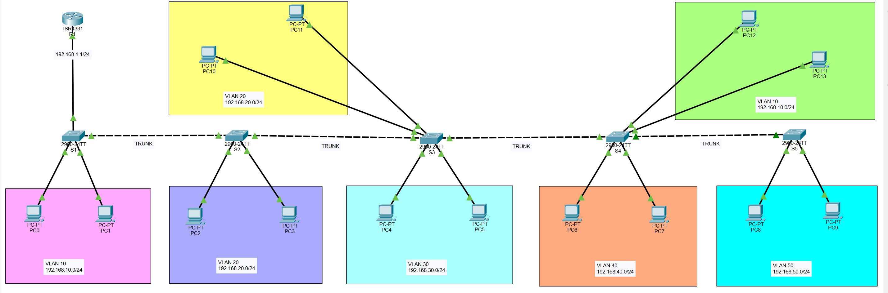
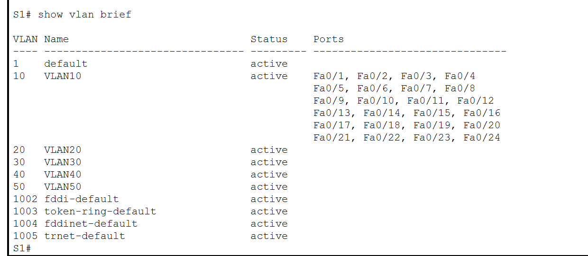
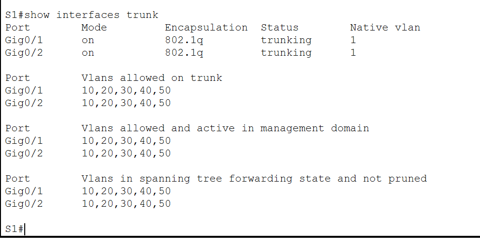
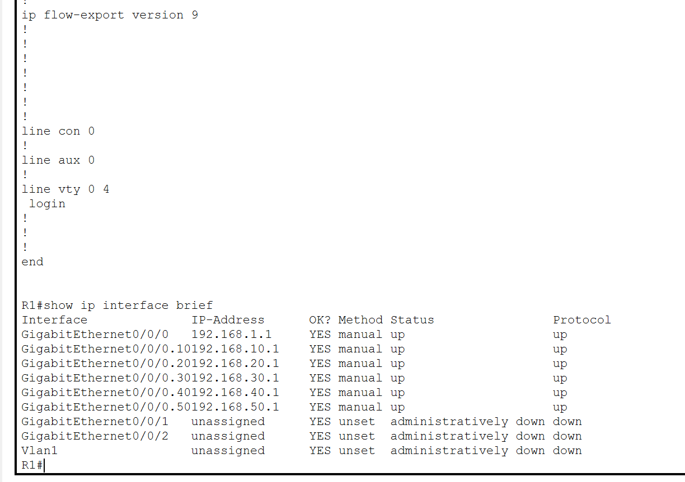
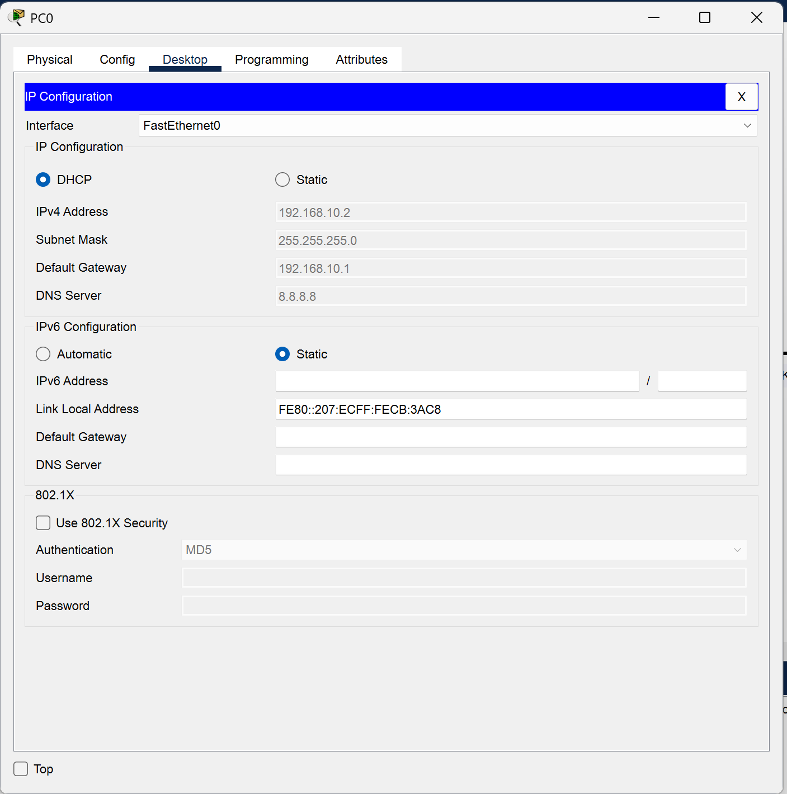
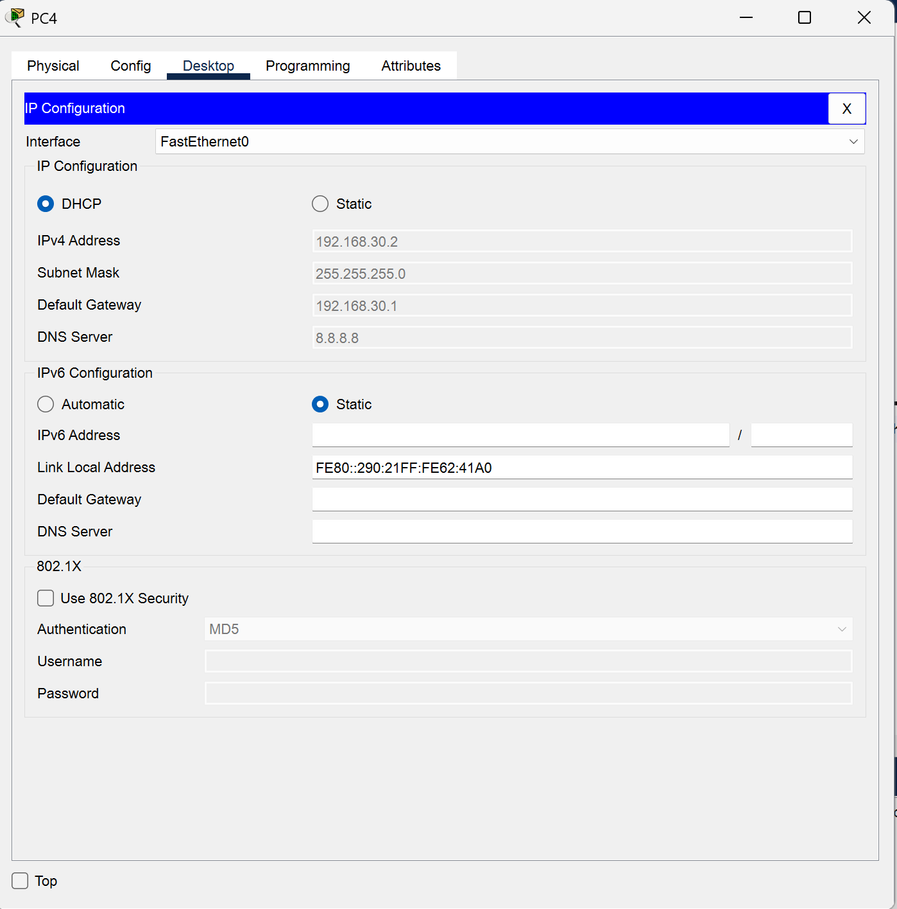
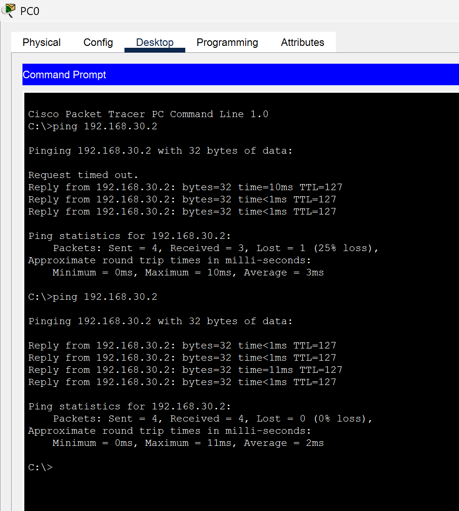

# Lab 1: DHCP, VLANs and Inter-VLAN Routing

A Cisco Packet Tracer lab completed during the advanced cybersecurity training at IBT College.

## Objective

Build a switched network with five VLANs spread across five switches, have a router hand out IP addresses to every VLAN using DHCP, and let devices in different VLANs communicate through inter-VLAN routing.

## Topology



| VLAN | Subnet | Gateway (R1) | Devices |
|------|--------|--------------|---------|
| 10 | 192.168.10.0/24 | 192.168.10.1 | PC0, PC1 (S1) and PC12, PC13 (S4) |
| 20 | 192.168.20.0/24 | 192.168.20.1 | PC2, PC3 (S2) and PC10, PC11 (S3) |
| 30 | 192.168.30.0/24 | 192.168.30.1 | PC4, PC5 (S3) |
| 40 | 192.168.40.0/24 | 192.168.40.1 | PC6, PC7 (S4) |
| 50 | 192.168.50.0/24 | 192.168.50.1 | PC8, PC9 (S5) |

Devices: 1 x ISR4331 router (R1), 5 x Catalyst 2960-24TT switches (S1 to S5), 14 PCs.

## Design

- **Router-on-a-stick inter-VLAN routing.** R1 connects to S1 with a single trunk link. Each VLAN has its own subinterface on `GigabitEthernet0/0/0` (`.10` to `.50`) using 802.1Q encapsulation, and the subinterface address is that VLAN's default gateway.
- **Trunks between switches.** The links between S1 to S5 are trunks allowing VLANs 10, 20, 30, 40 and 50. VLAN 10 and VLAN 20 each exist on two different switches and stay in the same broadcast domain through these trunks.
- **DHCP on the router.** R1 has one DHCP pool per VLAN. The gateway address (.1) of each subnet is excluded so it is never handed out to a PC.

## Key configuration

Full configs are in [`configs/`](configs/).

**R1: subinterface and DHCP pool for VLAN 10 (the other VLANs follow the same pattern)**

```
ip dhcp excluded-address 192.168.10.1
!
ip dhcp pool VLAN10
 network 192.168.10.0 255.255.255.0
 default-router 192.168.10.1
 dns-server 8.8.8.8
!
interface GigabitEthernet0/0/0.10
 encapsulation dot1Q 10
 ip address 192.168.10.1 255.255.255.0
```

**S1: access ports and trunk ports**

```
interface FastEthernet0/1
 switchport access vlan 10
 switchport mode access
!
interface GigabitEthernet0/1
 switchport trunk allowed vlan 10,20,30,40,50
 switchport mode trunk
```

## Verification

**1. VLANs and trunks on S1.** `show vlan brief` shows VLANs 10 to 50, and `show interfaces trunk` shows both gigabit ports trunking with 802.1Q and VLANs 10, 20, 30, 40, 50 allowed.




**2. Router interfaces.** `show ip interface brief` on R1 shows the physical interface and all five subinterfaces up/up, each with its gateway address.



**3. DHCP.** PC0 (VLAN 10) received `192.168.10.2` and PC4 (VLAN 30) received `192.168.30.2`, each with the correct subnet mask, default gateway and DNS server from its pool.




**4. Inter-VLAN connectivity.** PC0 (VLAN 10) pinged PC4 (VLAN 30) at `192.168.30.2`. The first ping had one timeout, which is normal while the router and PCs learn each other's MAC addresses (ARP). The second attempt had 0% loss. The TTL of 127 shows the packets crossed one router hop.



## What I learned

- How subinterfaces on one router link give every VLAN its own gateway (router-on-a-stick).
- Why trunk links must allow the VLANs they need to carry, and how one VLAN can span several switches.
- Why the gateway address must be excluded from the DHCP pool, and how one router can serve a separate pool for each VLAN.
- How to verify a design layer by layer: VLANs and trunks, router interfaces, DHCP leases, then end-to-end ping.

## Files

```
lab-1-dhcp-vlan-intervlan/
├── README.md
├── lab-1-dhcp-vlan-intervlan.pkt   (Packet Tracer file)
├── topology.png
├── configs/
│   ├── R1-running-config.txt
│   └── S1-running-config.txt
└── images/                         (verification screenshots)
```

To open the lab, install Cisco Packet Tracer and open the `.pkt` file.
